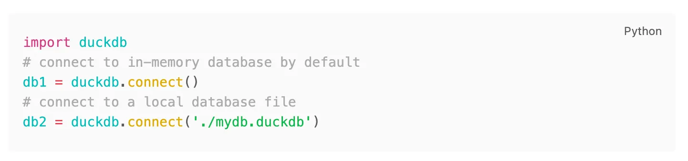
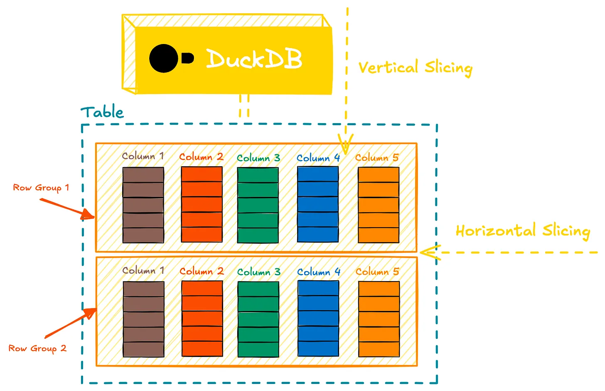
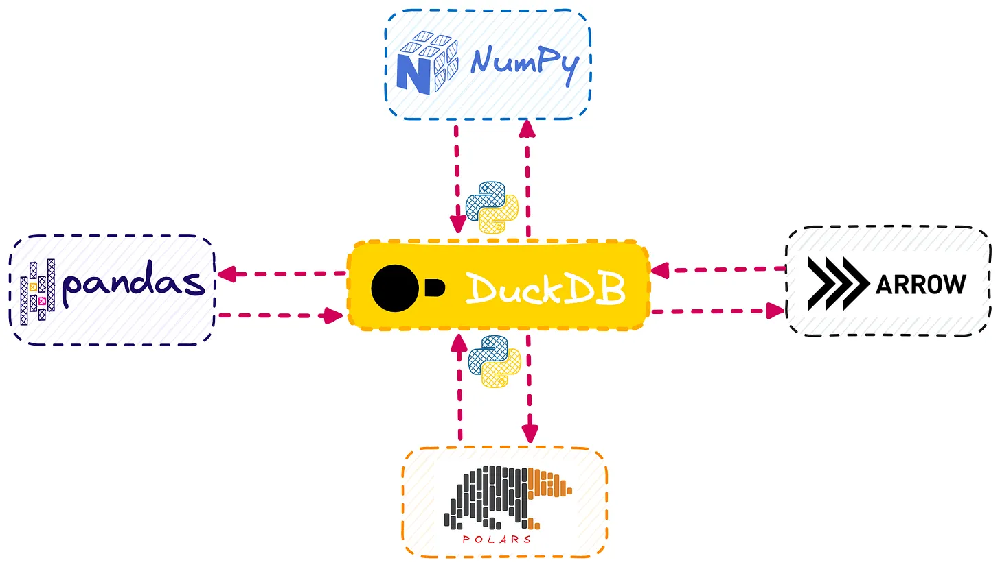
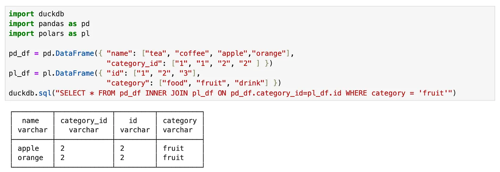
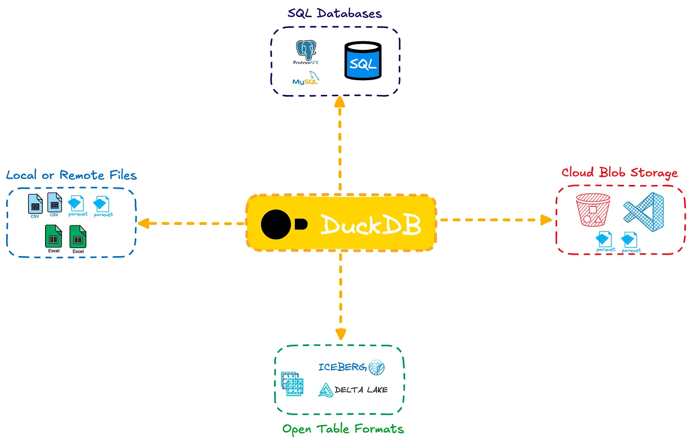
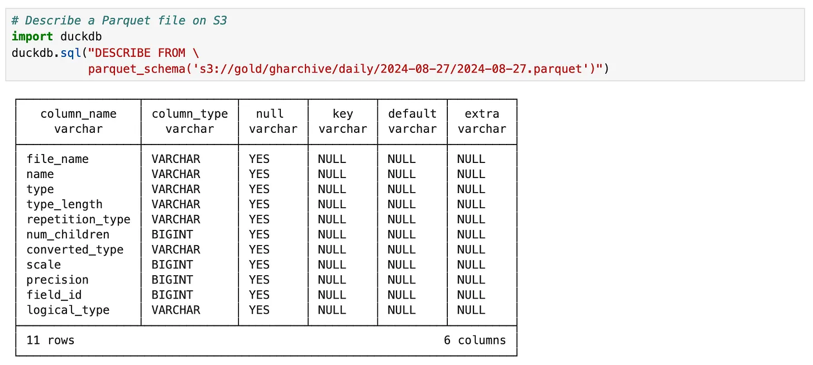

# DuckDB Beyond the Hype

Link: https://www.pracdata.io/p/duckdb-beyond-the-hype

## What DuckDB is

### An Embeddable & Portable Database

DuckDB is an **embeddable** database system (described in [DuckDB: an Embeddable Analytical Database](https://duckdb.org/pdf/SIGMOD2019-demo-duckdb.pdf) paper).

Like SQLite, it allows you to store your data in a single `.duckdb` database file, making it easily portable within other projects.

Besides being embeddable, DuckDB operates much like traditional DBMS systems, but without requiring a long-running server process like MySQL or PostgreSQL. There’s no need for starting a database server and establish a socket connection to it over IP/hostname and port.

All you need to do is point to where the single DuckDB database file is stored, or start an in-memory session without even requiring to use a physical database.

### A Columnar OLAP Database

DuckDB is a columnar database, making it highly efficient for running analytical queries.

DuckDB supports two main storage formats: its native `.duckdb` format or open-standard file formats like Parquet, which DuckDB reads and writes with impressive efficiency, including support for predicate pushdown.

Internally, DuckDB uses a row-columnar structure. Data is sliced into row-groups containing 120,000 records, and within each group, columns are stored separately and compressed—similar to popular binary formats like Parquet and ORC. This architecture allows you to efficiently store and query analytical datasets.

### Interoperable SQL-Powered DataFrame

The DuckDB’s Python library integrates seamlessly with popular DataFrame libraries like Pandas and Polars, allowing efficient in-memory operations. 

DuckDB can run SQL queries directly on Python DataFrames. You can query Pandas, Polars and Apache Arrow DataFrame objects as though they were SQL tables.

For some frameworks such as Apache Arrow, DuckDB uses [zero-copy mode](https://duckdb.org/2021/12/03/duck-arrow) for fast conversion. Using zero-copy mode, no serialisation is required for translating the in-memory objects between different representation.

You can join data from different objects, such as a Polars DataFrame, and a Pandas DataFrame, in a single SQL query. The results can be stored back into a DuckDB database or exported to file formats like Parquet on external storage.

### A Federated Query Engine

DuckDB offers a simple, efficient way to query external data systems through its [extensions](https://duckdb.org/docs/2.0/extensions/overview). Similar to distributed query engines such as Athena, Presto or Trino, it allows seamless joins across various external data sources.

You can directly query DBMS systems like MySQL and Postgres, open data files like JSON, CSV, and Parquet files stored in cloud storage systems like Amazon S3, and modern open table formats like Apache Iceberg and Delta Lake.

Though DuckDB doesn't have the concept of external tables found in systems like Hive or Redshift, you can still create persistent Views over the external tables or data files, like a read-only external table.

Querying a remote file in cloud storage can be done without downloading the entire file.

### A Single-Node Compute Engine

DuckDB can also act as a single-node compute engine, performing ephemeral batch transformations. It’s like having a stand-alone Spark for smaller-scale workloads.

This is particularly useful in scenarios like data lake architectures, where DuckDB can efficiently serialise raw data (e.g., JSON or CSV) into optimised formats like Parquet, and then transform or aggregate that data.

## What DuckDB can be

- **The Missing Piece in the Data Scientist's Toolbox**: DuckDB enables data scientists to work with a relational SQL database directly within their Python environment, eliminating the need for external database installations and the associated data transfer overhead.
- **Bring Your Own Compute**: DuckDB enables a "bring-your-own-compute" model, which allows users to leverage their local machines to run analytics on shared data, whether that data is stored locally or in the cloud.
- **A Standard Format for Publishing Relational and Analytical Datasets**: The DuckDB format (`.duckdb` database file) has the potential to become the standard for sharing relational data on the internet. Instead of exporting multiple data objects as separate CSV files, dataset publishers can export a complete dataset as a single duckdb file, containing all the data in an optimised, ready-to-analyse columnar format.
- **Expand DataFrames' Footprint in Data Engineering**: The DuckDB Python package bridges SQL and Python, allowing users to query Python in-memory objects like Pandas DataFrames as if they were database tables. This capability makes DataFrames accessible to a wider audience, including those more comfortable with SQL than Python.
- **Turn OLTP Databases into HTAP**:

    - The [introduction](https://motherduck.com/blog/pg_duckdb-postgresql-extension-for-duckdb-motherduck/) of [pg_duckdb](https://github.com/duckdb/pg_duckdb) and also [pg_analytics](https://github.com/paradedb/pg_analytics) is another exciting development

        - `pg_duckdb` extension: run analytical queries directly within Postgres database without needing to offload data to separate analytical systems.
        - `pg_analytics` extension: directly run queries over datasets stored on object stores like S3, and open table formats like Iceberg or Delta Lake directly from Postgres, using the embedded DuckDB as the underlying query engine.

    - Cloud ProstgreSQL providers such as [Crunchy Data](https://www.crunchydata.com/products/warehouse) are already integrating and taking advantage of DuckDB to extend their service offering for OLAP and analytical use cases.

- **In-Browser SQL Analytics**: Thanks to DuckDB’s WebAssembly implementation ([DuckDB-WASM](https://duckdb.org/2021/10/29/duckdb-wasm)), this brings SQL-powered analysis directly into the browser. For instance, Hugging Face introduced a [Datasets Explorer Chrome extension](https://huggingface.co/blog/cfahlgren1/querying-datasets-with-sql-in-the-browser), allowing users to explore their datasets using SQL directly in the browser—powered by DuckDB’s engine under the hood.